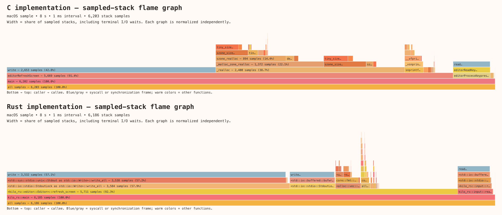

# kilo-rs

A small Rust terminal text editor inspired by [antirez/kilo](https://github.com/antirez/kilo), for macOS and Linux. It uses `libc` for POSIX terminal control and reuses a frame buffer across redraws.

## Build and run

Requires Rust with edition 2024 support (1.85 or newer) and an interactive POSIX terminal.

```sh
cargo build --release
./target/release/kilo-rs src/editor.rs
```

Passing a nonexistent filename starts a new buffer. Other file read errors are reported.

## Keys

- Arrow keys, PageUp, PageDown, Home, End: navigate.
- Enter, Tab, Backspace, Delete: edit.
- Ctrl-S: save.
- Ctrl-F: incremental search; arrows move between matching rows, Enter accepts, Escape cancels.
- Ctrl-Q: quit. With unsaved changes, press four consecutive times; another key resets the warning counter.

## Behavior and limits

The editor expands tabs to eight columns and provides basic C-style syntax highlighting for C, C++ and Rust extensions. Its highlighting is a small state machine, rather than a full language parser.

Editing and cursor movement operate on bytes. Non-ASCII bytes and control bytes are displayed as placeholders; Unicode character widths and grapheme-aware editing are not supported. File bytes remain intact unless edited. Filenames supplied through the CLI must be valid UTF-8.

Saving preserves existing LF/CRLF line endings and whether the file has a final newline. Newly inserted line breaks use LF. Saves write a temporary file beside the destination, sync it, then rename it over the destination. This requires write access to the parent directory, preserves permission bits and follows existing symlinks. Replacement changes the inode: ownership, extended attributes and hard-link relationships are not preserved.

Terminal attributes and cursor visibility are restored on normal exit, returned errors and Rust panic unwinding. Forced termination and aborts do not run Rust destructors.

The frame buffer retains its capacity, but can grow for larger screens. Formatting and search can allocate; there is no verified zero-allocation guarantee.

## Checks

```sh
cargo fmt --all -- --check
cargo clippy --all-targets -- -D warnings
cargo test
cargo build
python3 -m unittest discover -s tests -v
```

The tests cover editing sequences, syntax propagation, byte-preserving saves, file errors, key sequences, search coordinates, idle resize handling, and terminal restoration. PTY integration tests require macOS or Linux and the debug binary built by `cargo build`.

## Benchmarks

For a quick local redraw benchmark:

```sh
cargo build --release
python3 benchmark.py ./target/release/kilo-rs --scrolls 200 --runs 3
```

For the checked C/Rust comparison:

```sh
python3 outputs/benchmark-checked.py \
  --c-bin /path/to/kilo_stripped \
  --rust-bin ./target/release/kilo-rs \
  --file /path/to/kilo.c
```

That harness checks complete frames, logical line movement, the scrolling boundary and clean exit; it randomizes binary order across trials. Startup is excluded. Results measure PTY input-to-complete-frame wall time, not isolated render CPU time, terminal-emulator painting, allocations or memory usage.

The local run on November 15, 2026 used a 24×80 PTY, 10 warmup Down keys and 200 measured Down keys per trial, with seven trials per binary:

| Existing local binary | Median per 200 redraws | Minimum–maximum |
| --- | ---: | ---: |
| C `kilo_stripped` | 13.22 ms | 11.93–15.40 ms |
| Rust release | 6.48 ms | 5.77–8.43 ms |

Rust's median was 51.0% lower in this run. Both binaries moved from line 54 to 254 of the same 1,308-line file in every trial. The C binary was pre-existing; its compiler settings were not independently reproduced. These are local measurements, not a general performance guarantee. See [the full benchmark report](outputs/benchmark-report.md) and [raw measurements, workload hash and binary hashes](outputs/benchmark-checked-results.json).

## Stack flame graphs

The [C/Rust flame graph comparison](outputs/flames/README.md) includes PNGs, SVGs, raw samples, folded stacks and exact build commands. These are eight-second macOS wall-clock stack samples, including terminal I/O waits; they are not CPU-only measurements.



The profiling harness is `scripts/profile_flames.py`. It needs optimized binaries with symbols/frame pointers, macOS `sample` and `atos`, LLVM `llvm-cxxfilt`, and `rsvg-convert`. See the linked report for reproduction and interpretation.

## Source files

- `src/main.rs`: startup and resize event loop.
- `src/terminal.rs`: raw terminal mode and window size queries.
- `src/input.rs`: key and escape-sequence decoding.
- `src/row.rs`: row buffers, tab coordinates and highlighting.
- `src/editor.rs`: editing, rendering, search and file I/O.
- `benchmark.py`: portable single/multiple-binary PTY benchmark.
- `outputs/benchmark-checked.py`: the supplied checked comparison harness.
- `tests/test_terminal.py`: executable-level PTY integration tests.

`repomix-output.xml` is an older generated repository snapshot; use the source files above for the current implementation.
