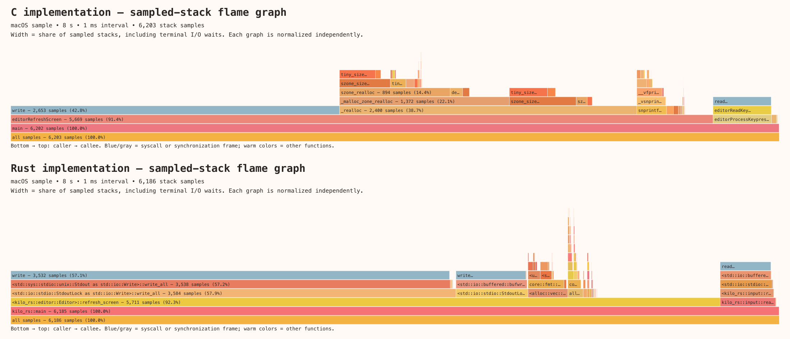

# C and Rust sampled-stack flame graphs

Created November 15, 2026 on macOS 15.5 (Apple Silicon).

- [C PNG](c-flamegraph.png) / [SVG](c-flamegraph.svg)
- [Rust PNG](rust-flamegraph.png) / [SVG](rust-flamegraph.svg)
- [Combined comparison PNG](comparison.png) / [SVG](comparison.svg)
- [Machine-readable profile results and binary hashes](profile-results.json)



## What the widths mean

These graphs use `/usr/bin/sample`: an eight-second sampling window with a requested one-millisecond interval. Sampling suspends the target and has overhead, so the actual counts are 6,203 for C and 6,186 for Rust, rather than exactly 8,000. Width is a share of stack samples; the graphs are independently normalized. This includes time in reads/writes, scheduler delays and blocked I/O. It is **not a CPU-only flame graph** or an allocation-count measurement. Horizontal position has no chronological meaning.

C has `2,440` samples (39.3%) in stacks containing `_realloc`. Terminal `write` appears in 42.8% of C samples and 66.2% of Rust samples. This shows a substantial allocation path in C's renderer and a larger relative I/O share in Rust. These proportions alone do not quantify a speedup. Use the separate checked benchmark for latency comparisons.

## Workload

Both freshly built editors loaded the same 1,308-line `kilo.c` file in a 24×80 pseudo-terminal. Startup was excluded. One PageDown and ten Down keys warmed up the viewport. The driver then repeated 512 Down followed by 512 Up keys, in batches of 64. Every completed frame was acknowledged; each batch's logical cursor position was checked. Each full cycle began and ended at line 54. Both editors exited cleanly.

The workload continued while `sample` initialized and resolved symbols, so the acknowledged-frame totals in `profile-results.json` extend beyond the eight-second collection window and **must not be treated as throughput measurements**. Neither implementation hit the end of the document during the cycles.

## Builds and reproduction

The existing stripped C executable was not suitable for readable application stack symbols. A separate optimized C binary was built from the local C source. Both profiling builds include symbols and frame pointers; these differ from the binaries in the preceding checked latency benchmark.

```sh
mkdir -p target/profiling-c
clang -O2 -g -fno-omit-frame-pointer ../kilo/kilo.c -o target/profiling-c/kilo
CARGO_TARGET_DIR=target/profiling \
CARGO_PROFILE_RELEASE_DEBUG=1 \
CARGO_PROFILE_RELEASE_STRIP=false \
RUSTFLAGS='-C force-frame-pointers=yes' cargo build --offline --release
xcrun dsymutil target/profiling/release/kilo-rs -o target/profiling/release/kilo-rs.dSYM
python3 scripts/profile_flames.py
```

Tools: Apple Clang 17.0.0, rustc 1.98.0, macOS `sample` and `atos`, LLVM `llvm-cxxfilt`, and librsvg `rsvg-convert`. `sample` must be allowed to inspect the editor processes; the Codex filesystem/process sandbox had to be lifted for this local profiling run. No system settings were changed.

The raw `*.sample.txt` files are retained. macOS initially left some Rust addresses unresolved; the harness resolved them with `atos -p` against that same live editor process before it exited. `*.sample.symbolicated.txt` retains the corrected symbols without changing sample counts. Rust names were demangled before producing `*.folded` files and the images. The converter checks inclusive/exclusive counts and rejects unresolved symbols or unrecognized call-tree lines. `--render-only` regenerates the images from the retained symbolicated reports.

Validation: PNGs were opened and visually inspected; folded totals and executable SHA-256 hashes match the manifest. Fourteen Rust tests, ten editor/benchmark PTY tests and two profile-converter tests passed; Rust formatting and Clippy with warnings denied passed.
